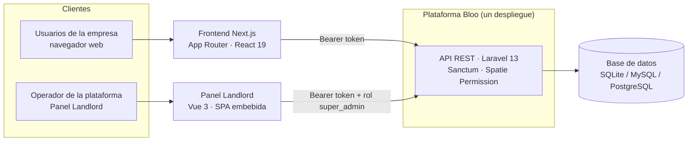

# Bloo — Documentación técnica

> Repositorio público de documentación de **Bloo**, un ERP SaaS multi-tenant. Aquí se documenta el diseño, los requisitos, las decisiones arquitectónicas y las convenciones de la plataforma — **este repositorio no contiene código ejecutable**.

**Estado:** MVP funcional en desarrollo activo · **Licencia de esta documentación:** [CC BY 4.0](LICENSE)

---

## ¿Qué es Bloo?

Bloo es una plataforma ERP (planificación de recursos empresariales) **multi-tenant** diseñada para pequeñas y medianas empresas. Una sola instalación de la plataforma atiende a muchas empresas ("tenants"), cada una con sus datos perfectamente aislados, su plan de suscripción y su conjunto de usuarios y permisos.

El sistema tiene dos caras:

| Cara | ¿Para quién? | ¿Qué resuelve? |
|---|---|---|
| **Aplicación ERP** | Usuarios de cada empresa (dueño, administradores, empleados) | Gestión diaria: clientes, productos, facturas, gastos, cuentas bancarias, impuestos y tableros Kanban. |
| **Panel Landlord** | Operador de la plataforma (rol `super_admin`) | Administración global: empresas (tenants), planes, pagos, respaldos, anuncios del sistema, auditoría y soporte. |

El contexto fiscal y monetario del MVP es México (RFC, IVA, montos en MXN), aunque el modelo de datos no impone esa restricción.

### El problema que resuelve

Las PYMES suelen elegir entre hojas de cálculo dispersas o suites ERP caras y difíciles de operar. Bloo propone una alternativa SaaS: acceso por suscripción, sin infraestructura propia por parte del cliente, con un modelo de roles granular que permite delegar tareas (ventas, almacén, contabilidad) sin compartir credenciales ni exponer datos entre áreas.

Para el operador de la plataforma, el desafío técnico es el inverso: **ejecutar un solo sistema para muchas empresas sin que los datos se mezclen nunca**. Toda la arquitectura documentada aquí gira alrededor de ese compromiso.

---

## Características principales

| Área | Implementado ✅ | En desarrollo 🚧 | Planeado 📋 |
|---|---|---|---|
| **Multi-tenancy** | Base de datos compartida con `company_id`, aislamiento verificado por pruebas | — | Resolución por dominio (`domain` ya existe en el modelo) |
| **Autenticación** | Tokens Bearer (Sanctum), registro, login, recuperación de contraseña, revocación de tokens | — | Segundo factor (columnas reservadas) |
| **Autorización** | 5 roles por empresa, ~107 permisos, contexto de equipo Spatie | — | Refuerzo de verificación de permisos por ruta |
| **Catálogos** | Productos, marcas, categorías, unidades, almacenes (con imágenes y stock) | — | — |
| **Clientes y facturas** | CRUD, folios automáticos `INV-AAAA-NNNN`, ciclo de vida de factura | — | — |
| **Finanzas** | Gastos, impuestos, cuentas bancarias y movimientos | — | Presupuestos, flujo de caja |
| **Trabajo** | Tablero Kanban (boards/columnas/tarjetas) | — | Módulos de RRHH, proyectos y CRM (solo permisos y plantillas de UI) |
| **Panel Landlord** | CRUD de tenants, planes, pagos, impersonación, respaldos, auditoría, salud del sistema | — | Facturación automática de suscripciones |
| **Frontend** | Next.js conectado a la API: login, clientes, facturas, gastos, productos, anuncios | Resto de pantallas (plantillas con datos simulados) | Conexión progresiva de módulos |
| **Operación** | Docker dev/prod, logs, auditoría de acciones del landlord | — | Tareas asíncronas, rate limiting, versionado de API |

> **Importante:** documentar un módulo no significa que esté implementado. Cada documento de este repositorio indica su estado. El inventario completo de rutas del frontend y su estado de conexión se detalla en [docs/overview.md](docs/overview.md).

---

## Arquitectura en pocas capas

- Cada registro operativo pertenece a una empresa mediante `company_id`.
- El tenant se identifica por el **token** (no por dominio ni subdominio): token → usuario → `company_id`.
- El Panel Landlord corre en rutas `/api/admin/*` protegidas por rol, **sin** contexto de tenant.

Detalle completo en [docs/architecture/system-design.md](docs/architecture/system-design.md).

---

## Navegar la documentación

| Documento | Contenido |
|---|---|
| [docs/overview.md](docs/overview.md) | Qué es Bloo, actores, dominios y estado real por módulo |
| [docs/requirements.md](docs/requirements.md) | Requisitos funcionales y no funcionales |
| [docs/roadmap.md](docs/roadmap.md) | Estado actual, backlog y dirección futura |
| **Arquitectura** | |
| [system-design.md](docs/architecture/system-design.md) | Componentes, responsabilidades y comunicación |
| [tenancy-model.md](docs/architecture/tenancy-model.md) | Cómo se identifica y aísla cada tenant |
| [data-model.md](docs/architecture/data-model.md) | Entidades, relaciones e integridad por tenant |
| [authentication-and-authorization.md](docs/architecture/authentication-and-authorization.md) | Sesiones, tokens, roles y permisos |
| [error-handling.md](docs/architecture/error-handling.md) | Estrategia de errores y modo mantenimiento |
| [decisions/](docs/architecture/decisions/) | ADR: registro de decisiones arquitectónicas |
| **API** | |
| [conventions.md](docs/api/conventions.md) | Convenciones generales del contrato HTTP |
| [pagination-filtering-sorting.md](docs/api/pagination-filtering-sorting.md) | Paginación, búsqueda y filtros |
| [error-responses.md](docs/api/error-responses.md) | Formatos de respuesta de error |
| **Seguridad** | |
| [tenant-isolation.md](docs/security/tenant-isolation.md) | Capas de defensa del aislamiento entre empresas |
| [threat-model.md](docs/security/threat-model.md) | Activos, límites de confianza y amenazas mitigadas |
| **Operación** | |
| [logging.md](docs/operations/logging.md) | Canales de log y auditoría |
| [configuration.md](docs/operations/configuration.md) | Variables de entorno y despliegue |
| **Diagramas** | [diagrams/](diagrams/) — fuentes Mermaid (`system-context`, `tenancy-model`, `request-lifecycle`) |

La referencia exhaustiva de endpoints vive en el backend: [`erp-api/docs/API.md`](https://github.com/ThejavaZ/erp-api/blob/main/docs/API.md). Aquí documentamos **convenciones y diseño**, no duplicamos el listado.

---

## Repositorios del proyecto

| Repositorio | Contenido | Rol |
|---|---|---|
| `ThejavaZ/Bloo-Docs` | Este repositorio: documentación técnica (Markdown + Mermaid) | Público |
| `ThejavaZ/erp-api` | Backend Laravel 13 + Panel Landlord (Vue 3) | Implementación |
| `ThejavaZ/erp-client` | Frontend Next.js 16 | Implementación |

Este repositorio se mantiene **independiente de la implementación** a propósito: permite evolucionar el diseño y publicar decisiones sin abrir el código fuente, y obliga a que la documentación describa el sistema por sus comportamientos y contratos, no por sus detalles internos.

---

## Privacidad y seguridad de la información

La documentación pública describe el **diseño** del sistema: modelo de datos conceptual, convenciones de API, estrategias de aislamiento y decisiones. **Nunca** incluye:

- Código fuente de los repositorios de implementación.
- Credenciales, claves, tokens o valores reales de variables de entorno.
- Datos personales de usuarios reales ni información comercial confidencial.
- Detalles operativos que deban permanecer privados (endpoints internos de infraestructura, valores de monitoreo, etc.).

---

## Licencia

Esta documentación se publica bajo [Creative Commons Attribution 4.0 International (CC BY 4.0)](LICENSE). Puedes compartirla y adaptarla libremente, incluso comercialmente, siempre que menciones la fuente.

> La licencia de este repositorio aplica **solo a la documentación**. El software de los repositorios de implementación mantiene su propia licencia.
