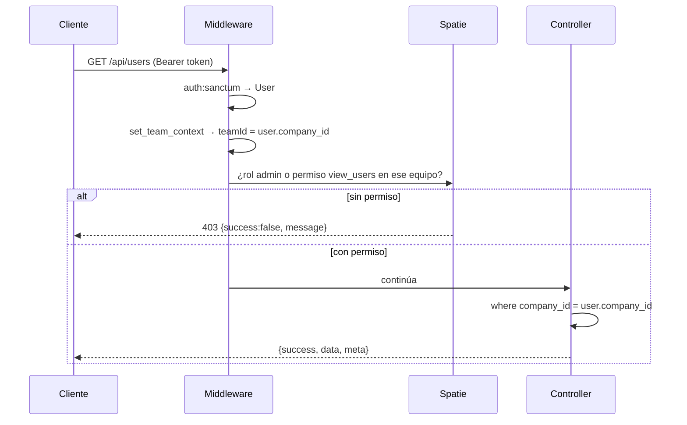

# Autenticación y autorización

> Estado: ✅ Implementado. Tokens Bearer (Sanctum) + roles y permisos por equipo (Spatie Permission).

## Autenticación

### Mecanismo

**Laravel Sanctum con tokens personales (Bearer).** El cliente guarda el token y lo envía en cada petición:

```http
Authorization: Bearer <token>
```

- La API es **stateless**: no usa cookies de sesión (el guard configurado es `web` para compatibilidad, pero las rutas se sirven con `auth:sanctum`).
- El token se genera al hacer login con `createToken` y se almacena hasheado en `personal_access_tokens`.

### Endpoints públicos

| Método | Ruta | Propósito |
|---|---|---|
| POST | `/api/login` | Devuelve token, usuario, roles y permisos |
| POST | `/api/register` | Alta de usuario (dentro de una empresa) |
| POST | `/api/check-email` | Verificación de disponibilidad de correo |
| POST | `/api/forgot-password` | Envía enlace de recuperación |
| POST | `/api/reset-password` | Restablece la contraseña con el token del broker |

### Endpoints de sesión (`/api/auth/*`)

Exentos del modo mantenimiento para que el usuario siempre pueda cerrar sesión:

| Método | Ruta | Efecto |
|---|---|---|
| GET | `/api/auth/user` | Usuario actual con roles y permisos (lo usa el frontend al cargar) |
| PUT | `/api/auth/profile` | Actualiza perfil |
| POST | `/api/auth/change-password` | Cambia contraseña y **revoca los demás tokens** |
| POST | `/api/auth/logout` | Elimina el token actual |
| POST | `/api/auth/revoke-tokens` | Revoca todos los tokens del usuario |

### Comportamientos de sesión

- **Usuario inactivo** (`is_active = false`): el login responde 403 aunque la contraseña sea correcta.
- **Expiración:** los tokens no expiran por defecto (política revisada en el [roadmap](../roadmap.md)). La única excepción es el token de impersonación del Landlord, con TTL de 1 hora.
- **Revocación en cascada:** cambiar la contraseña corta las demás sesiones activas del usuario.
- **Recuperación de contraseña:** usa el broker estándar de Laravel con tabla `password_reset_tokens` (caduca en 60 minutos, con límite de reintentos). En desarrollo, el correo se escribe en el log.

### Frontend

El token se guarda en `localStorage` y Axios lo inyecta automáticamente. Ante un 401 global se limpia el token y se redirige a `/login` con aviso «Sesión expirada»; ante un 403 se redirige a `/forbidden`. Ver [ADR-0005](decisions/0005-frontend-split-and-auth-flow.md) para el porqué y los tradeoffs.

## Autorización

### Equipos Spatie: roles que viven dentro de una empresa

Spatie Permission está configurado en modo **teams**:

- `teams = true`, `team_foreign_key = team_id`.
- En la práctica, `team_id` de un rol **es** el `company_id` del usuario.
- El guard efectivo es `api` (definido en el modelo de usuario).
- El middleware `set_team_context` fija el equipo en cada petición antes de cualquier verificación.

Consecuencia: **un rol asignado en la empresa A no existe para el mismo usuario en la empresa B.** La matriz de permisos es un espacio por tenant.

La columna `roles.is_global` y el `team_id` nullable permiten en el futuro roles de plataforma sin romper el modelo actual.

### Matriz de roles (por empresa)

| Rol | Perfil | Alcance típico |
|---|---|---|
| `super_admin` | Dueño / administrador supremo de la empresa | Todos los permisos del tenant |
| `admin` | Administrador | Amplio subconjunto, incluye gestión de usuarios, roles y vista de auditoría |
| `manager` | Gerente de área | Permisos de operación de su dominio |
| `employee` | Empleado | Ejecución acotada (por ejemplo, ver y crear en su módulo) |
| `guest` | Invitado / auditor | Solo lectura mínima |

### Permisos

~**107 permisos** con nomenclatura uniforme `ver_*`, `crear_*`, `editar_*`, `eliminar_*` sobre ~18 módulos: dashboard, ventas, compras e inventario, finanzas (contabilidad, facturas, gastos, banca, impuestos, presupuestos, flujo de caja), RRHH, proyectos, CRM, marketing, logística, servicios, reportes, administración, configuración y sistemas.

> Los módulos de RRHH, CRM, marketing y logística están **definidos como permisos** aunque sus endpoints no existan aún. Esto permite construir el menú y la matriz de roles antes que el backend.

### Verificación en la API

Dos mecanismos conviven:

1. **Refuerzo por ruta** con los middlewares de Spatie (`role_or_permission:…`), aplicado hoy en gestión de usuarios y en los catálogos de inventario (categorías, marcas, unidades, almacenes).
2. **Aislamiento de tenant** como barrera general: cualquier usuario autenticado puede operar los recursos de su empresa; la separación entre áreas se refina con permisos (estado: mejorando, ver [roadmap](../roadmap.md)).

### Frontend

El menú lateral se genera desde configuración, y **cada elemento declara su permiso**: sin ese permiso, el elemento no se renderiza. Es comodidad de uso, no seguridad — la seguridad vive en la API.

## Acceso del operador de plataforma (Landlord)

| Aspecto | Implementación |
|---|---|
| Rutas | `/api/admin/*` |
| Protección | `auth:sanctum` + middleware `ensure_superadmin` |
| Contexto de tenant | **No se fija equipo**: el superadmin ve todas las empresas |
| Impersonación | `POST /api/admin/tenants/{id}/impersonate` emite un token temporal (1 hora, nombre `landlord-support`) para operar dentro del tenant como soporte; queda registrado en auditoría |
| Revocación | `POST /api/admin/tenants/{id}/revoke-tokens` corta todas las sesiones de la empresa |

La impersonación es una decisión de soporte deliberada: acota el acceso con un TTL corto y lo hace **rastreable** (acción `tenant.impersonate` en el log de auditoría).

## Flujo completo de una verificación



## Brechas reconocidas

- No hay rate limiting en login ni en recuperación de contraseña.
- Los tokens no expiran ni se rotan automáticamente.
- El 2FA tiene columnas reservadas pero ningún flujo.
- La verificación de permisos por ruta no cubre todos los módulos financieros aún.

Todas están en el [roadmap](../roadmap.md); ninguna compromete el aislamiento entre empresas, que es verificado por pruebas.
