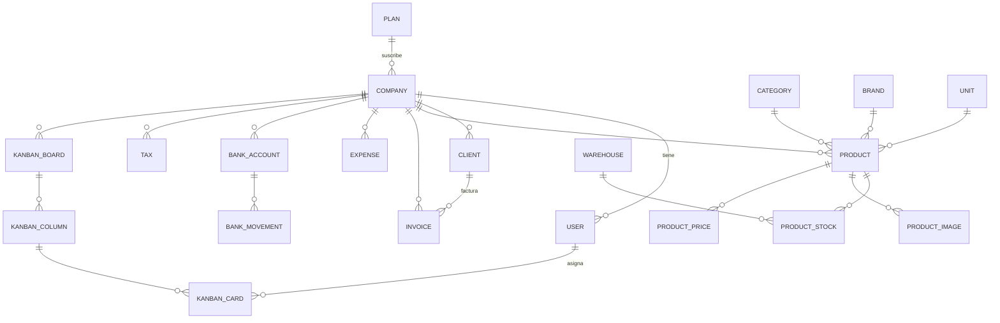

# Modelo de datos

> Estado: ✅ Implementado. 23 modelos y 31 migraciones en el backend.

## Principios

1. **Todo dato de negocio lleva `company_id`** con clave foránea a `companies` y borrado en cascada. Es la base del aislamiento (ver [tenancy-model.md](tenancy-model.md)).
2. **Únicidades compuestas por tenant**, nunca globales (SKU, RFC, folio, código de impuesto, correo de usuario).
3. **Borrado lógico selectivo:** solo donde perder el registro histórico haría daño. Las entidades financieras se dan de baja de forma física.
4. **Instantáneas sobre relaciones volátiles:** cuando un documento debe sobrevivir a cambios del registro que lo originó, se copia el dato (por ejemplo, `client_name` en la factura).
5. **Moneda y fiscalidad por tenant:** moneda por defecto MXN y tasas de impuesto configurables por empresa.

## Mapa de entidades

## Dominios y tablas

### Organización e identidad

| Tabla | Notas |
|---|---|
| `companies` | El tenant. `slug` único global, `tax_id` (RFC), datos de contacto, logo, `settings` JSON, soft deletes. Campos de plataforma: `plan_id`, `subscription_ends_at`, `trial_ends_at`, `status`, `domain` (reservado), `users_limit`, `is_in_maintenance` |
| `users` | `company_id` **nullable** (el superadmin de plataforma no pertenece a un tenant), unicidad `(email, company_id)`, `is_active`, `last_login_at/ip`, `language`, `timezone`, `preferences` JSON, columnas reservadas para 2FA, soft deletes |
| `user_logins` | Auditoría de intentos de autenticación (fecha, IP, resultado) |
| `password_reset_tokens`, `sessions` | Infraestructura estándar de Laravel |

### Plataforma (tablas del Landlord)

| Tabla | Notas |
|---|---|
| `plans` | `slug` único, precio, `limit_users` (default 5), `limit_products` (default 100), `is_active` |
| `company_payments` | Pagos de suscripción: `status` (`paid`/`pending`/`failed`), `due_at`. Solo los pagados cuentan para el MRR |
| `admin_audit_logs` | Acciones del superadmin: `action`, `target_company_id`, IP, `details_json` |
| `system_announcements` | Anuncios globales (sin `company_id`): `type` (`info`/`warning`/`danger`), ventana `starts_at`–`ends_at` |

### Catálogos de producto

| Tabla | Unicidad por tenant | Soft deletes |
|---|---|---|
| `categories` | — | ✅ |
| `brands` | — | ✅ |
| `units` | — | — |
| `warehouses` | — | ✅ |
| `products` | `(company_id, sku)` | ✅ |

`products` concentra: nombre, SKU, código de barras, `category_id` obligatoria, marca/unidad opcionales, `cost_price` y `sale_price` (`decimal(12,2)`), `tax_rate` (`decimal(5,2)`, default 16) y `attributes` JSON para extensibilidad sin migración.

Tablas asociadas: `product_images`, `product_prices` (historial de precios), `product_stocks` (stock por almacén), `product_category` (relación pivote).

### Ventas y finanzas

| Tabla | Unicidad por tenant | Notas |
|---|---|---|
| `clients` | `(company_id, rfc)` | `type`: Persona Física / Empresa / Gobierno; `status`: Activo / Inactivo / Prospecto |
| `invoices` | `(company_id, invoice_number)` | Folio automático `INV-AAAA-NNNN`; `status`: draft → issued → paid → overdue → cancelled; montos `decimal(14,2)`; `client_name` como instantánea |
| `expenses` | — | Categorías de operación/nómina/servicios/impuestos/otros; `status`: Pendiente / Pagado |
| `taxes` | `(company_id, code)` | `kind`: IVA / ISR / IEPS / Retención, `rate` |
| `bank_accounts` | — | Banco, número de cuenta, saldo, moneda |
| `bank_movements` | — | Tipo ingreso/egreso, monto, ligado a cuenta |

Ninguna de las tablas financieras usa soft deletes: la baja es física y la trazabilidad se da por los documentos (facturas, movimientos), no por registros fantasma.

### Trabajo (Kanban)

`kanban_boards` → `kanban_columns` → `kanban_cards`, con tres particularidades:

- **Llave primaria UUID** en las tres tablas (las únicas del sistema).
- `order_position` para el orden explícito de columnas y tarjetas.
- `assigned_to` en las tarjetas apunta a un usuario de la misma empresa.

### Autorización (Spatie)

Tablas `roles`, `permissions`, `model_has_roles`, `model_has_permissions`, `role_has_permissions` con la particularidad de que **`roles.team_id` es nullable** (para permitir roles globales de plataforma) y existe una columna booleana extra, `is_global`, en `roles`.

## Reglas de integridad destacadas

- **Cascada desde el tenant:** eliminar una empresa elimina en cascada sus registros de negocio.
- **Folio incremental por año:** el número de factura se genera por empresa y año; la unicidad compuesta garantiza que dos empresas no colisionen.
- **Instantánea en factura:** si el cliente cambia de nombre o se elimina, la factura conserva el nombre con el que se emitió.
- **Saldo en cuenta bancaria:** derivado de los movimientos registrados; el modelo lo mantiene como columna para lectura rápida (consistencia bajo responsabilidad de la aplicación).

## Lo que el modelo aún no tiene

- Tablas de RRHH, proyectos, CRM o marketing: existen como **permisos** y menús, no como entidades. Ver [../requirements.md](../requirements.md).
- Tablas de suscripción por evento (invoices de la plataforma, historial de cambios de plan).
- Tablas de notificaciones (Laravel las dejaría listas al activar el canal).
