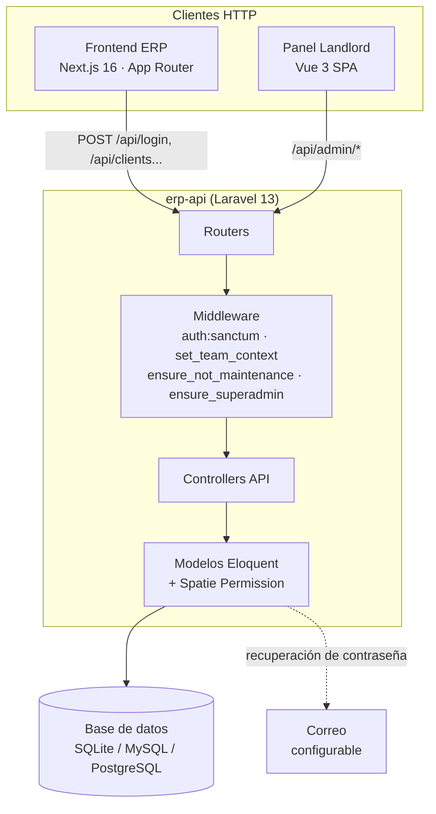
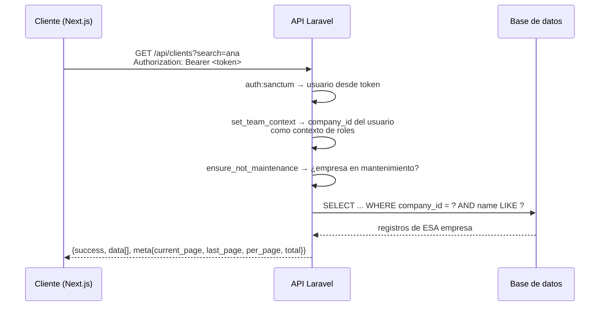

# Diseño del sistema

> Estado: ✅ Implementado. Describe la arquitectura actual del MVP.

## Vista general

Bloo se despliega como **una sola aplicación** que sirve a todos los tenants. No hay instancias por empresa ni bases de datos separadas: el aislamiento es lógico, enforced en cada capa (ver [tenancy-model.md](tenancy-model.md) y [../security/tenant-isolation.md](../security/tenant-isolation.md)).

## Componentes

### 1. Backend `erp-api` — API REST (Laravel 13)

Responsabilidades:

- **Autenticación y autorización:** tokens Bearer (Sanctum) y roles/permisos por equipo (Spatie Permission con `team_id = company_id`).
- **API de negocio:** CRUD de clientes, facturas, gastos, productos, catálogos, impuestos, cuentas bancarias y tableros Kanban.
- **API Landlord:** administración global de tenants, planes, pagos, respaldos, anuncios, auditoría y salud del sistema.
- **Servicios de plataforma:** generación de respaldos por tenant (volcado SQL comprimido) y registro de auditoría.

Es una aplicación Laravel estándar: sin servicios separados, sin colas activas (la infraestructura existe pero sin jobs implementados) y con la lógica de negocio principalmente en controllers y modelos.

### 2. Frontend ERP — Next.js 16 (repositorio `erp-client`)

- App Router con React 19, TypeScript estricto y Tailwind CSS v4.
- Capa de datos tipada: una instancia única de Axios con interceptor de peticiones (inyección de `Authorization: Bearer`) y de respuestas (401 → sesión expirada, 403 → acceso denegado).
- El token se guarda en `localStorage`; el `AuthContext` valida la sesión contra `GET /api/auth/user` al cargar.
- Menú lateral generado desde configuración, con permiso declarado por elemento: los items sin permiso no se muestran.

### 3. Panel Landlord — Vue 3 embebido en el backend

SPA compilada con Vite servida desde las rutas `/admin` del propio backend. Comparte despliegue con la API, lo que elimina la necesidad de un segundo servicio para la operación interna. Sus peticiones consumen `/api/admin/*`, protegidas por rol `super_admin`.

### 4. Base de datos

- **SQLite** por defecto (cero configuración para empezar; compatible con MySQL y PostgreSQL vía entorno).
- Almacena también caché, sesiones y trabajos pendientes (tablas estándar de Laravel).
- En el despliegue de producción Docker, el archivo SQLite y `storage/` viven en un volumen persistente.

### 5. Correo

El mailer es configurable por entorno; por defecto escribe a log (útil en desarrollo). El único flujo que lo usa hoy es la recuperación de contraseña.

## Flujo de una petición de negocio

El diagrama completo está en [../../diagrams/request-lifecycle.mmd](../../diagrams/request-lifecycle.mmd).

## Superficies HTTP

| Prefijo | Público | Protección | Audiencia |
|---|---|---|---|
| `/api/login`, `/api/register`, `/api/forgot-password`, `/api/reset-password`, `/api/check-email` | Sí | — | Cualquiera |
| `/api/system/announcements` | Sí | — | Anuncios globales activos |
| `/api/auth/*` | No | Token + exento de mantenimiento | Usuario autenticado |
| `/api/*` (clientes, facturas, productos…) | No | Token + contexto de tenant + no mantenimiento | Usuario de empresa |
| `/api/admin/*` | No | Token + rol `super_admin` (sin contexto de tenant) | Operador de plataforma |
| `/admin` (SPA Landlord) y `/` (SPA frontend) | Sí (el shell) | El acceso real depende de la API | — |
| `/up` | Sí | — | Salud del despliegue |

## Estrategia de errores

Sin personalización profunda: se aprovechan los defaults del framework (422 de validación, 401 de autenticación, 404 de recurso inexistente) y los errores de negocio se construyen en cada controller con el sobre `{success: false, message}`. Detalle en [error-handling.md](error-handling.md).

## Despliegue

| Entorno | Cómo | Notas |
|---|---|---|
| Desarrollo | `docker compose up` o `php artisan serve` + `npm run dev` | Código montado en el contenedor (cambios al instante) |
| Producción | `docker compose -f docker-compose.prod.yml up -d --build` | Imagen multi-etapa: compila el frontend y el panel, instala Composer sin dependencias dev, OPcache activo, Apache como servidor |
| Frontend prod | Imagen standalone (~280 MB, usuario no-root) | La URL de la API se inyecta **al momento de compilar** |

`APP_KEY` y la bandera de migración al arrancar se inyectan por variables de entorno; nunca quedan dentro de la imagen.

## Decisiones que dan forma al diseño

| Decisión | Documento |
|---|---|
| Laravel 13 como backend | [ADR-0001](decisions/0001-selection-of-backend-framework.md) |
| Base de datos SQLite/relacional compartida | [ADR-0002](decisions/0002-database-strategy.md) |
| Aislamiento por `company_id` + equipos Spatie | [ADR-0003](decisions/0003-tenant-isolation-strategy.md) |
| Sobre de respuesta `{success, data, meta}` | [ADR-0004](decisions/0004-api-response-conventions.md) |
| Frontend Next.js en repositorio separado | [ADR-0005](decisions/0005-frontend-split-and-auth-flow.md) |
| Panel Landlord como SPA embebida | [ADR-0006](decisions/0006-landlord-panel-embedded-spa.md) |

## Limitaciones conocidas del diseño actual

- **Una sola capa de aplicación:** el backend es monolítico. Para el volumen de un MVP es una ventaja operativa; a escala, los respaldos y los reportes pesados deberán moverse a tareas asíncronas.
- **Sin capa de servicios:** la lógica vive en controllers y modelos. Cuando la regla de negocio crezca (por ejemplo, ciclo de vida de facturas + impuestos + inventario), convendrá extraer servicios.
- **Sin rate limiting ni versionado de API:** anotados en el [roadmap](../roadmap.md).
